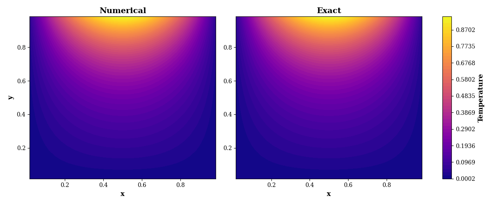
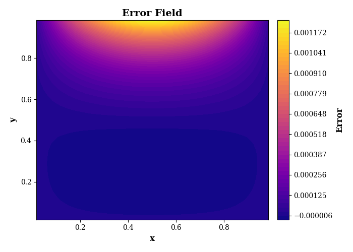
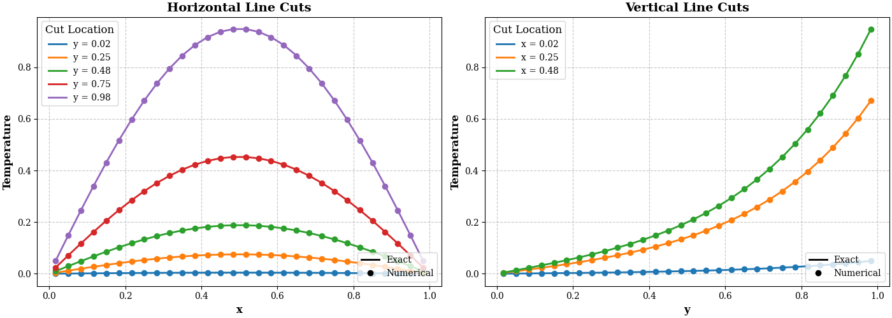
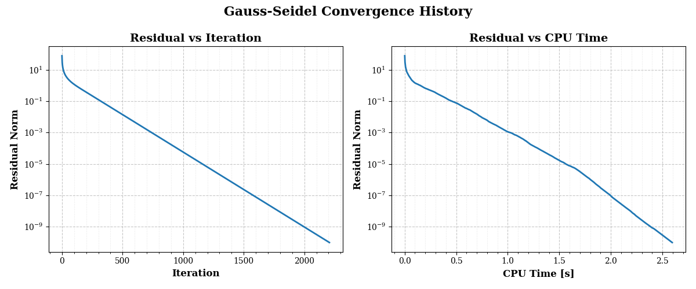
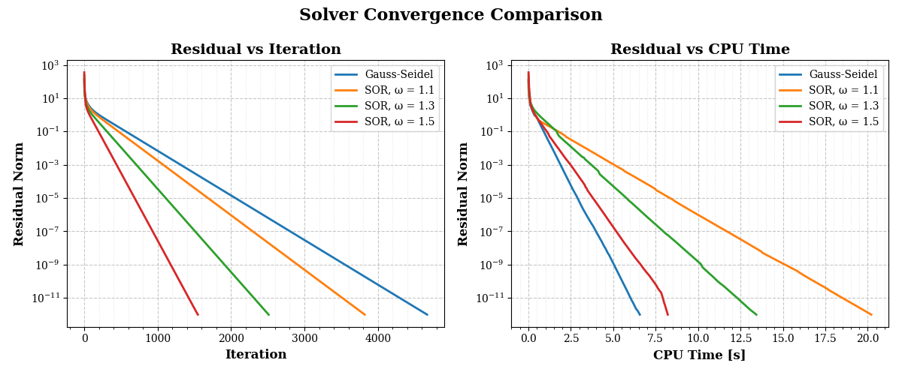
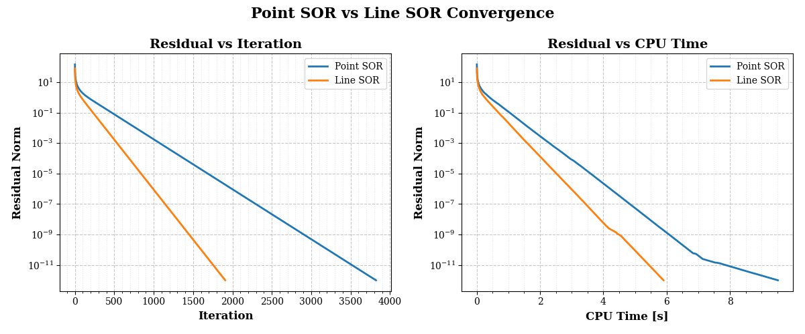
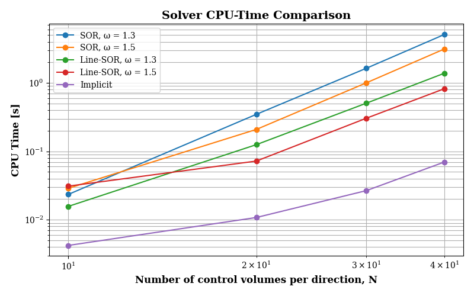

# V2 — Modular Finite-Volume Solver for Steady Two-Dimensional Heat Conduction

A Python implementation of a cell-centered finite-volume method for solving the steady-state heat conduction equation on a square domain. This version extends the original implementation into a modular numerical framework and compares four solution methods in terms of convergence, numerical accuracy, and computational cost.

The project combines numerical discretization, iterative and direct linear-system solution methods, analytical verification, and computational studies.

**[Read the V2 Report (PDF)](report/CFD_Project_01_Heat_Conduction_V2.pdf)**

## 1. Problem Description

The problem is governed by the two-dimensional Laplace equation:

$$
\nabla^2 T =
\frac{\partial^2 T}{\partial x^2}
+
\frac{\partial^2 T}{\partial y^2}
=0
$$

The computational domain is a unit square, with the following Dirichlet boundary conditions:

$$
T(x,0)=T(0,y)=T(1,y)=0
$$

$$
T(x,1)=\sin(\pi x)
$$

The equation is discretized using a second-order, cell-centered finite-volume formulation on a structured Cartesian grid. Ghost cells are used to impose the boundary conditions.

The analytical solution is

$$
T(x,y)=
\frac{\sin(\pi x)\sinh(\pi y)}
{\sinh(\pi)}
$$

This solution provides a reference for verifying the numerical temperature field and quantifying the discretization error.

## 2. Numerical Solution Methods

Four numerical methods are implemented and compared.

### Point Gauss-Seidel

The baseline iterative method updates control-volume temperatures sequentially, using the most recently available neighboring values. Convergence is monitored using the \(L_2\) norm of the residual.

### Successive Over-Relaxation (SOR)

SOR introduces a relaxation factor, \(\omega\), into the point-wise Gauss-Seidel update. The effect of the relaxation factor is investigated using

$$
\omega=1.1,\quad 1.3,\quad 1.5
$$

The study compares convergence in terms of iteration count and CPU time on a \(40\times40\) mesh.

### Line-SOR

Line-SOR solves for temperature corrections along entire vertical lines of control volumes. The method is semi-implicit: coupling in the vertical direction is treated implicitly, while coupling in the horizontal direction is treated explicitly.

The relaxation factor is set to \(\omega=1.1\) for the initial comparison with point-wise SOR. Additional mesh-size studies examine Line-SOR using \(\omega=1.3\) and \(1.5\).

The line systems have tridiagonal coefficient matrices. In the current implementation, these systems are solved using NumPy's `numpy.linalg.solve()`; a specialized tridiagonal solver is not yet implemented.

### Fully Implicit Direct Method

The discretized equations for all control volumes are assembled into a single linear system,

$$
\mathbf{A}\mathbf{X}=\mathbf{d}
$$

The resulting system is solved directly using `numpy.linalg.solve()`. The current implementation uses a dense coefficient matrix, and the measured computational time includes matrix assembly and solution.

## 3. Project Structure

The code separates numerical algorithms, shared utilities, computational studies, and the main execution script.

```text
V2/
├── src/
│   ├── __init__.py
│   ├── config.py
│   ├── initialization.py
│   ├── boundary_condition.py
│   ├── residual.py
│   ├── grid.py
│   ├── exact_solution.py
│   ├── visualization.py
│   └── solvers/
│       ├── __init__.py
│       ├── gauss_seidel.py
│       ├── sor.py
│       ├── line_sor.py
│       └── implicit.py
├── studies/
│   ├── __init__.py
│   ├── gauss_seidel_verification.py
│   ├── gauss_seidel_mesh_size_study.py
│   ├── gs_sor_comparison.py
│   ├── line_sor_comparison.py
│   └── implicit_study.py
├── report/
│   ├── CFD_Project_01_Heat_Conduction_V2.pdf
│   └── latex/
├── main.py
├── requirements.txt
└── README.md
```

The `src/` package contains the numerical solvers and shared computational functions. The `studies/` package defines the experiments, collects solver results, and prepares comparisons. The `main.py` script is the entry point for running the selected study.

## 4. Verification and Numerical Results

The numerical implementation is evaluated using the analytical solution, error fields, temperature profiles, residual histories, and solver-performance comparisons.

### Temperature Distribution

The numerical temperature field obtained using Point Gauss-Seidel is compared with the analytical solution. The contour plots provide a visual assessment of their agreement.



### Error Field

The pointwise signed error is defined consistently as

$$
e=T_{\mathrm{numerical}}-T_{\mathrm{exact}}
$$

The error contour illustrates how the numerical solution differs from the analytical solution across the domain.



### Line-Cut Comparison

Horizontal and vertical temperature profiles provide additional comparisons between the numerical and analytical solutions.



### Point Gauss-Seidel Convergence

The residual history is examined as a function of iteration count and CPU time. These plots establish the baseline for comparing the iterative methods.



## 5. Solver Comparison Studies

### Point Gauss-Seidel vs. SOR

The influence of the SOR relaxation factor is examined on a \(40\times40\) mesh with a residual tolerance of \(10^{-12}\).

In one recorded benchmark, Point Gauss-Seidel required 4672 iterations, whereas SOR with \(\omega=1.5\) required 1549 iterations. The corresponding recorded CPU times were 6.1124 s and 3.2679 s, respectively.

SOR with \(\omega=1.1\) reduced the iteration count but did not improve the measured CPU time in that run. This illustrates why iteration count and elapsed computation time should be evaluated separately.



### Point-SOR vs. Line-SOR

The two methods are compared using \(\omega=1.1\), the same \(40\times40\) mesh, and the same convergence tolerance.

In the dedicated recorded comparison, Point-SOR required 3823 iterations and 8.0495 s, whereas Line-SOR required 1909 iterations and 2.2451 s. Line-SOR therefore used approximately half as many iterations and reduced the recorded CPU time by about 72%.



### CPU Time vs. Mesh Resolution

The mesh-size study compares SOR, Line-SOR, and the fully implicit direct method for \(N=10,20,30,40\) control volumes in each direction.

In the recorded \(N=40\) study, the direct method took 0.0976 s, compared with 3.1708 s for SOR with \(\omega=1.5\) and 0.8401 s for Line-SOR with \(\omega=1.5\). These measurements apply to the tested mesh sizes and computational environment; they should not be interpreted as evidence that a dense direct solver will remain more efficient for arbitrarily large systems.



## 6. Fully Implicit Solution Verification

The fully implicit solution is also compared with the analytical temperature field on a \(40\times40\) mesh.

The recorded verification results are:

| Quantity                              |                   Value |
| ------------------------------------- | ----------------------: |
| \(L_2\) error                         | \(1.6122\times10^{-4}\) |
| Maximum absolute error                | \(7.2049\times10^{-4}\) |
| Final residual in the mesh-size study |  \(3.50\times10^{-13}\) |

The error measures quantify the difference from the analytical solution, while the residual measures how closely the numerical field satisfies the discretized equations. They therefore assess different aspects of the computation.

### Numerical and Analytical Temperature Fields


### Fully Implicit Error Field


## 7. How to Run

### Requirements

Python and the packages listed in `requirements.txt` are required. The numerical implementation uses NumPy for array operations and linear-system solution and Matplotlib for visualization.

### Installation

Clone the repository and navigate to the V2 directory:

```bash
git clone https://github.com/Arian-Shahnoori/cfd-project-01-heat-conduction.git
cd cfd-project-01-heat-conduction/V2
```

Install the required packages:

```bash
pip install -r requirements.txt
```

### Run a Study

Run the main script from the V2 directory:

```bash
python main.py
```

The study selected in `main.py` will be executed. To run another experiment, open `main.py` and select the corresponding study function from the `studies/` package.

The available studies cover analytical verification, mesh-size convergence, Point Gauss-Seidel vs. SOR, Point-SOR vs. Line-SOR, and the implicit direct-solver comparison.

## 8. Limitations and Future Work

The current implementation is intended as a compact, transparent framework for studying finite-volume discretization and numerical solution techniques.

Potential extensions include:

* Implementing the Thomas algorithm for the tridiagonal systems in Line-SOR.
* Using sparse matrix storage and sparse direct solvers for larger implicit systems.
* Performing more extensive grid-convergence studies and systematic timing benchmarks.
* Extending the implementation to more general transport equations and boundary conditions.

## Report

The detailed mathematical formulation, solver derivations, implementation discussion, and numerical results are documented in the accompanying report:

**[CFD_Project_01_Heat_Conduction_V2.pdf](report/CFD_Project_01_Heat_Conduction_V2.pdf)**
