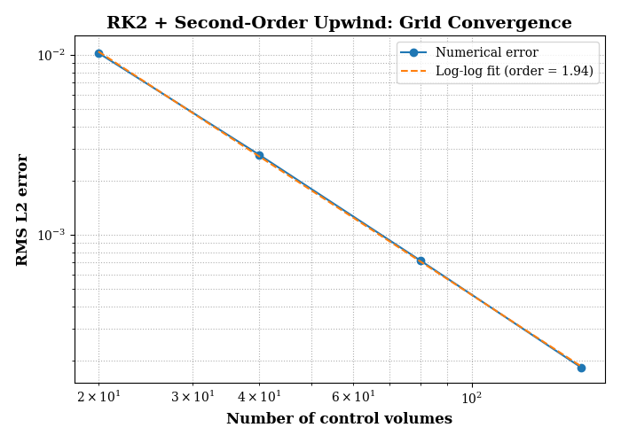
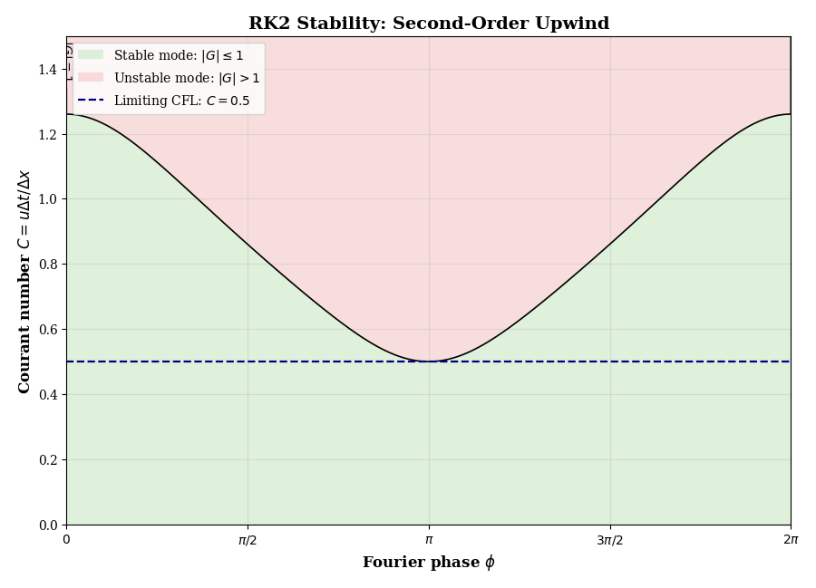
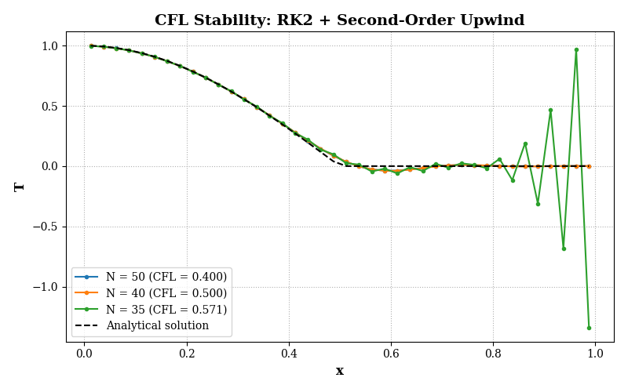

# Finite-Volume Solver for the 1D Linear Advection Equation

A modular Python implementation for solving the one-dimensional linear advection equation using finite-volume spatial discretization and explicit Runge--Kutta time integration. The project compares spatial schemes, examines CFL stability limits through Fourier analysis, and evaluates numerical accuracy against an analytical solution.

## Quick links

- [Entry point: `main.py`](main.py)
- [Spatial and temporal solver components](src/solvers/)
- [Shared analysis and visualization utilities](src/)
- [Numerical studies](studies/)
- [Generated results](results/figures/)
- [LaTeX report and report figures](report/latex/)

## Overview

The governing equation is

$$
\frac{\partial T}{\partial t}+u\frac{\partial T}{\partial x}=0,
\qquad 0\leq x\leq L.
$$

The initial and inlet conditions are

$$
T(x,0)=0,\qquad T(0,t)=\sin(2\pi t).
$$

The default parameters are a domain length of $L=1$ and a constant advection velocity of $u=2$. The analytical solution used to assess numerical error is

$$
T(x,t)=
\begin{cases}
\sin\!\left(2\pi\left(t-\frac{x}{u}\right)\right), & x\leq ut,\\
0, & x>ut.
\end{cases}
$$

This problem transports a prescribed inlet signal through the domain and provides a useful test case for studying numerical diffusion, dispersion, temporal accuracy, and stability.

## Features

- Cell-centred finite-volume formulation on a uniform grid.
- Second-order upwind and second-order central spatial discretizations.
- Explicit midpoint Runge--Kutta method (RK2) and classical fourth-order Runge--Kutta method (RK4).
- Analytical solution for error evaluation.
- RMS discrete $L^2$ error and grid-convergence studies.
- Fourier-mode amplification-factor analysis and stability maps.
- Separate study scripts and shared plotting utilities.
- Configurable spatial scheme, time integrator, CFL number, grid resolution, and final time.

## Numerical method

For a cell-centred finite-volume discretization, the semi-discrete equation is

$$
\frac{dT_i}{dt}=-\frac{u}{\Delta x}
\left(T_{i+1/2}-T_{i-1/2}\right),
$$

where $T_{i+1/2}$ and $T_{i-1/2}$ denote the reconstructed values at the right and left faces of cell $i$. For positive velocity, the second-order upwind scheme gives the interior right-hand side

$$
\frac{dT_i}{dt}=-\frac{u}{2\Delta x}
\left(3T_i-4T_{i-1}+T_{i-2}\right).
$$

The inlet cells use a boundary treatment consistent with the prescribed time-dependent inlet value. The temporal integrator advances the resulting semi-discrete system using either midpoint RK2 or classical RK4.

The Courant number is defined as

$$
C=\frac{u\Delta t}{\Delta x}.
$$

When a target CFL number is specified, the solver selects a time-step count sufficient to reach the requested final time. Alternatively, the number of time steps can be prescribed directly.

## Repository structure

```text
.
├── main.py
├── src/
│   ├── analytical.py
│   ├── errors.py
│   ├── stability_analysis.py
│   ├── visualization.py
│   └── solvers/
│       ├── __init__.py
│       ├── spatial_operators.py
│       ├── time_integrators.py
│       └── solver.py
├── studies/
│   ├── __init__.py
│   ├── study_01_rk2_second_order_upwind_convergence.py
│   ├── study_02_rk2_second_order_upwind_stability.py
│   ├── study_03_rk2_second_order_upwind_cfl_validation.py
│   ├── study_04_rk2_second_order_central_convergence.py
│   ├── study_05_rk2_central_upwind_comparison.py
│   ├── study_06_rk4_second_order_upwind_stability.py
│   └── study_07_rk2_rk4_accuracy_comparison.py
├── results/
│   └── figures/
└── report/
    └── latex/
        └── figures/
```

`main.py` is the entry point for the configured studies. The reusable numerical methods are implemented under [`src/`](src/), while [`studies/`](studies/) contains the experiments and their parameter choices. Plotting routines are centralised in [`src/visualization.py`](src/visualization.py) to avoid duplicating figure-generation code across studies. The LaTeX report and its figures are in [`report/latex/`](report/latex/).

## Requirements

- Python 3
- NumPy
- Matplotlib

Install the core dependencies with:

```bash
python -m pip install numpy matplotlib
```

If the repository includes a `requirements.txt`, install the full environment with:

```bash
python -m pip install -r requirements.txt
```

## Running the project

From the project root (the directory containing `main.py`), run:

```bash
python main.py
```

This runs the studies configured in `main.py`. Figures generated by the studies are saved under [`results/figures/`](CFD_Project_02_1D_Advection/results/figures/). To run only a subset of experiments, adjust the study calls in `main.py` or run the relevant study script, provided it has a script entry point.

## Studies and results

### 1. RK2 with second-order upwind: grid convergence

At a fixed target CFL number of $C=0.25$, the grid was refined from 20 to 160 control volumes. The observed convergence order was **1.9378**, close to the expected second-order rate.

[](report/latex/figures/rk2_2ndupwind_convergence.png)

### 2. RK2 with second-order upwind: stability

Fourier analysis predicts an interior-scheme stability limit of

$$
C_{\max}=0.5.
$$

Tests with the full solver at a final time of $t=0.25$ were consistent with this prediction: the solution remained bounded at CFL values of 0.4 and 0.5, while instability appeared at approximately 0.5714. The case at the theoretical limit is marginal and should not be treated as a robust operating point.

[](report/latex/figures/rk2_2ndupwind_stability.png)

[](report/latex/figures/rk2_2ndupwind_solution.png)

### 3. Classical RK4 with second-order upwind: stability

For classical RK4 and the same spatial discretization, the theoretical interior-scheme limit is approximately

$$
C_{\max}\approx 0.6963.
$$

The sampled stability search gave approximately 0.6933; this small difference is due to the finite resolution of the numerical search grid.

[](report/latex/figures/rk4_2ndupwind_stability.png)

### 4. RK2 and RK4: accuracy comparison

On a fixed grid of 40 control volumes, reducing the time step decreased the RK2 error towards the nearly constant error measured with RK4. This indicates that the spatial discretization error dominated once the temporal error became sufficiently small.

In a grid-refinement study at a fixed CFL number of $C=0.05$, both methods gave an observed overall convergence order of approximately **1.9368**. Although RK4 has fourth-order temporal accuracy, the overall rate remained close to second order because both methods use a second-order spatial discretization.

[](report/latex/figures/rk2_rk4_convergence.png)

## Stability-analysis scope

The Fourier analysis uses periodic modes to examine the interior spatial discretization and its interaction with the time integrator. The actual initial-boundary-value problem is not periodic: it has a prescribed, time-dependent inlet condition. Therefore, the Fourier-derived CFL limits are interior-scheme stability criteria rather than a complete proof of stability for the full solver. Tests using the actual inlet treatment provide a numerical cross-check, but they do not establish a general stability guarantee for every grid and simulation time.

The analysis also predicts that second-order central differencing combined with explicit midpoint RK2 fails the absolute-stability condition for nonzero purely imaginary Fourier modes at any positive CFL number. A solution that appears acceptable over a short interval or on a coarse grid should not, by itself, be taken as evidence of long-time stability.

## Current limitations

- The central-versus-upwind comparison study is subject to a diagnostic consistency check: the recorded errors and maximum solution magnitudes were identical for the two spatial schemes. These outputs should be regenerated after verifying scheme selection and right-hand-side dispatch; they are not used here as evidence of a quantitative comparison.
- The grid-refinement study for central differencing currently uses only two resolutions, so its observed order is preliminary rather than a conclusive convergence verification.
- The Fourier stability maps address the interior discretization under periodic-mode assumptions; the boundary treatment is not covered by that analysis alone.

## Purpose

This project is intended as a numerical-methods study and a transparent, reproducible implementation of a small advection solver. It emphasises the connection between discretization choices, time integration, stability, and measured error rather than treating the solver as a black box.
