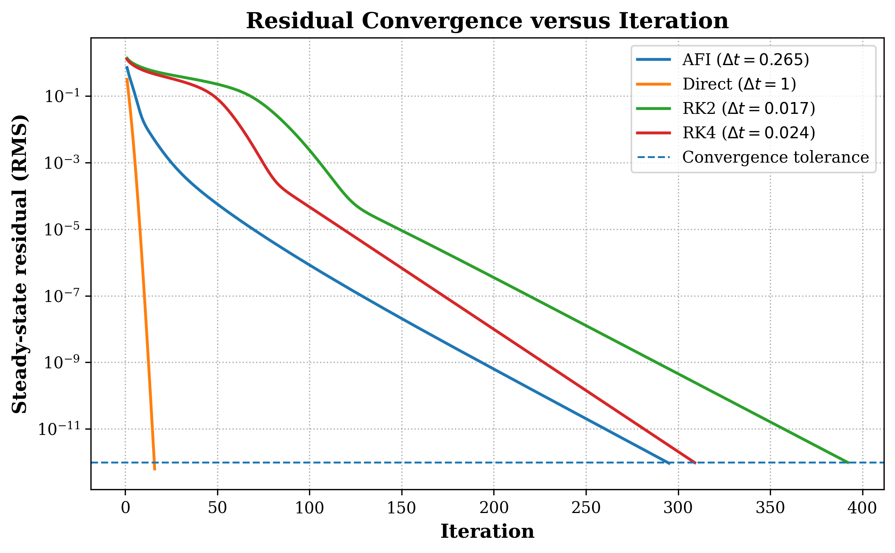
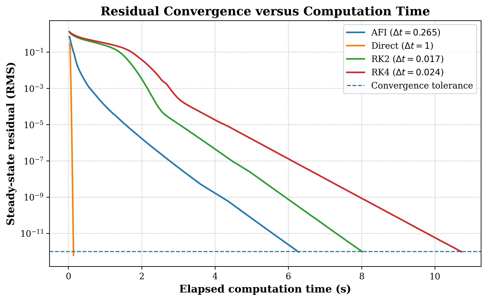
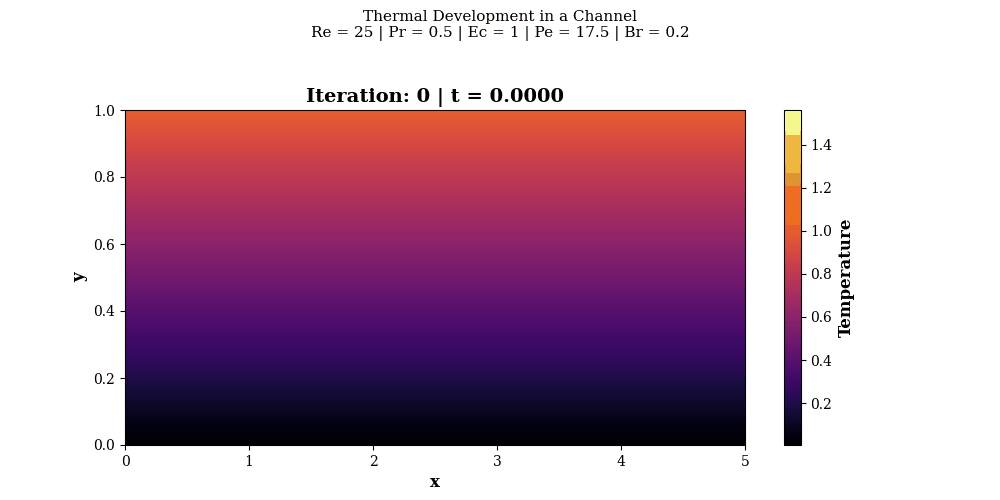
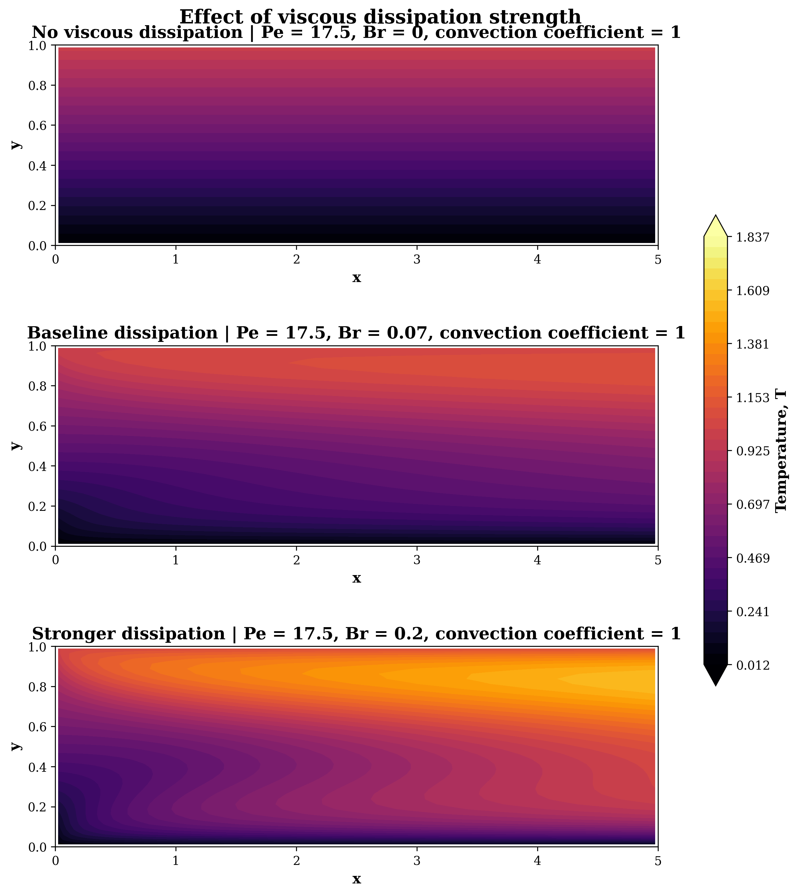
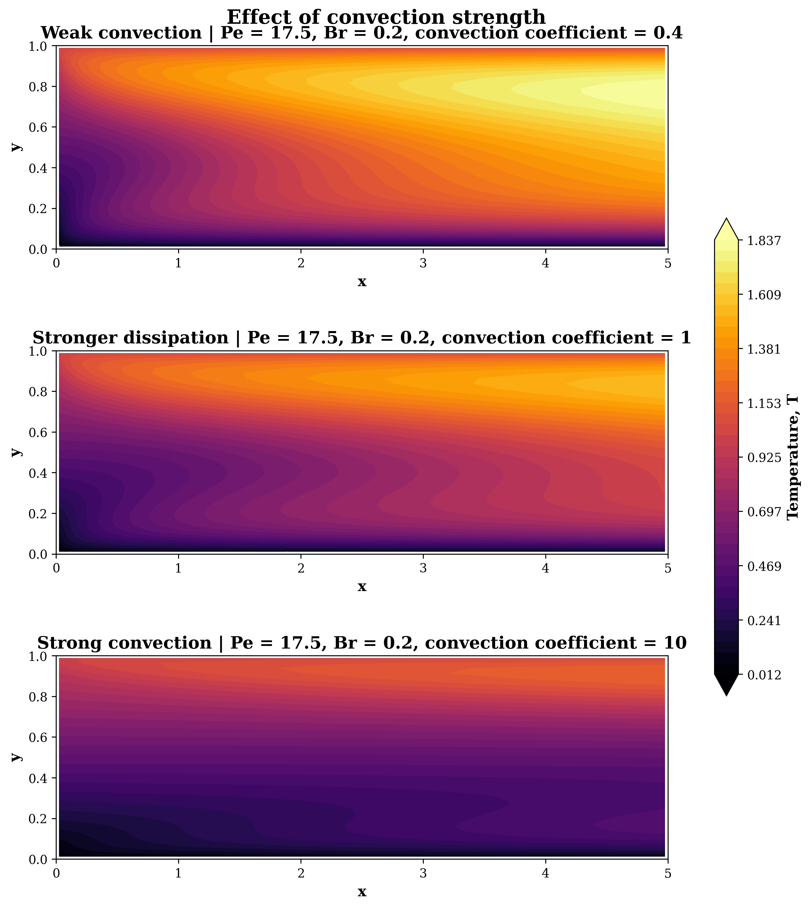
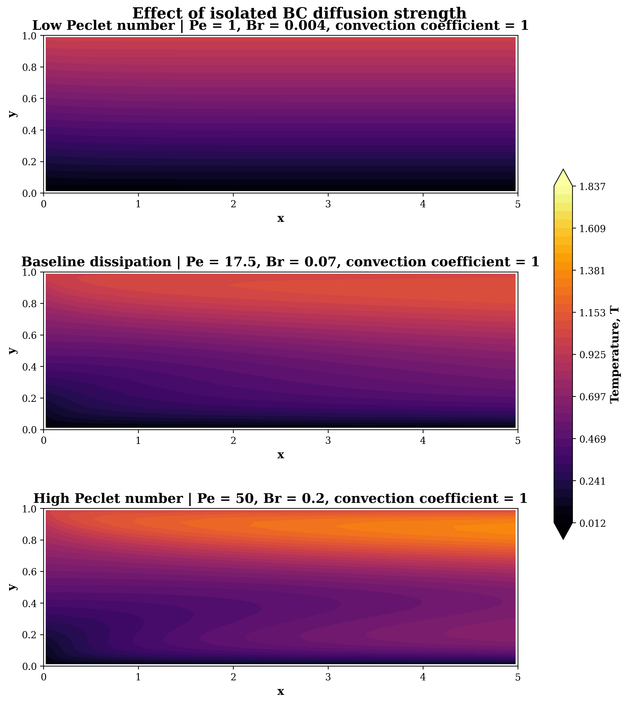
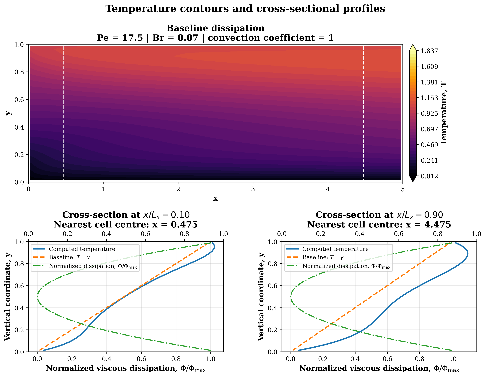
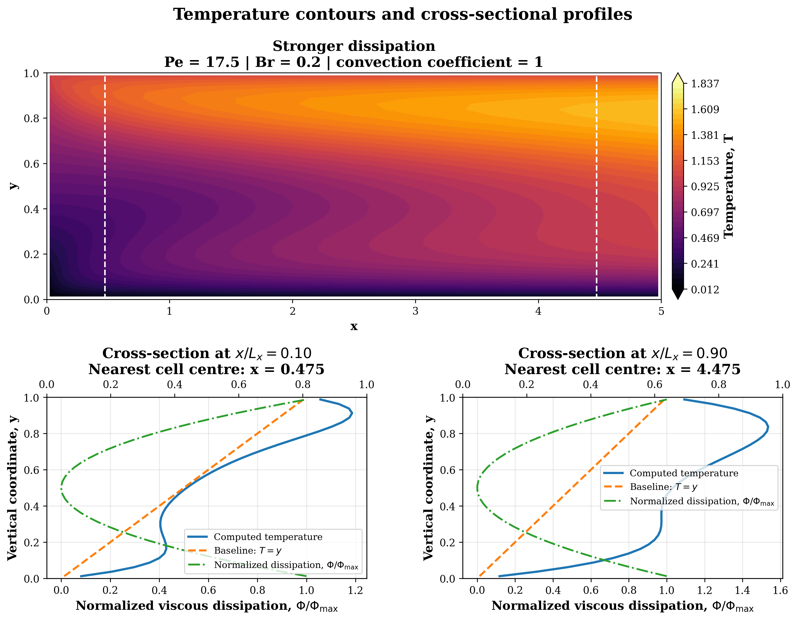
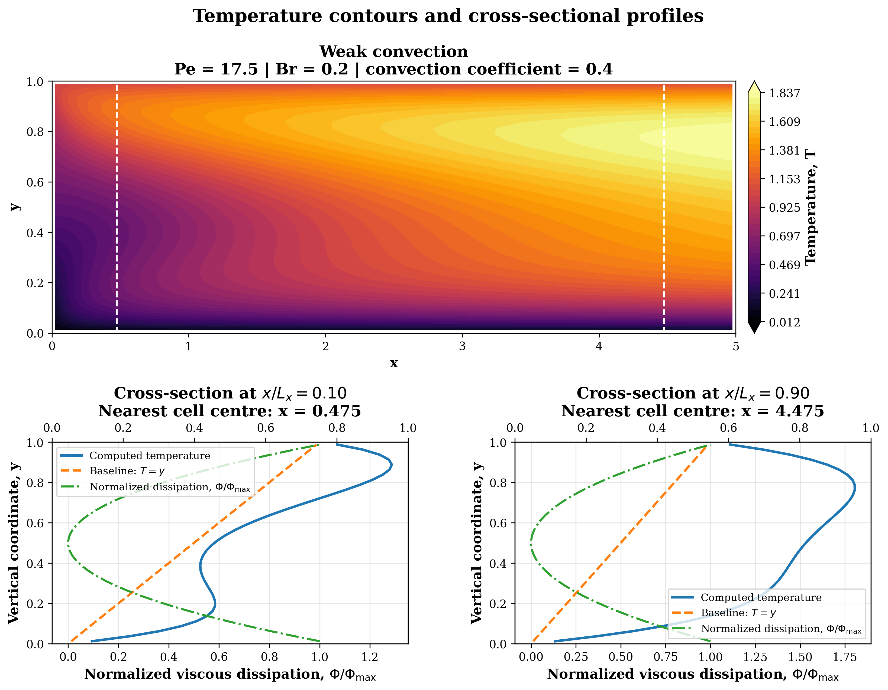

# Finite-Volume Solver for the 2D Channel-Flow Energy Equation

A modular Python implementation for solving the two-dimensional energy equation in a channel flow using finite-volume spatial discretization and pseudo-time integration. The project compares approximate factorization, sparse direct implicit, and explicit Runge–Kutta methods. It also examines numerical stability, solver performance, and the effects of convection, thermal diffusion, and viscous dissipation on the steady-state temperature field.

## Quick links

- [Source code](CFD_03_2D_Energy_Equation/Code/src/)
- [Solver implementations](CFD_03_2D_Energy_Equation/Code/src/solvers/)
- [Initialization and boundary conditions](CFD_03_2D_Energy_Equation/Code/src/initialization.py)
- [Visualization utilities](CFD_03_2D_Energy_Equation/Code/src/visualization/)
- [Solver-comparison results](CFD_03_2D_Energy_Equation/results/solver_comparison/)
- [Parameter-study results](CFD_03_2D_Energy_Equation/results/parameter_study/)
- [LaTeX report](CFD_03_2D_Energy_Equation/Report/main.tex)
- [Report sections](CFD_03_2D_Energy_Equation/Report/sections/)
- [Compiled report (PDF)](CFD_03_2D_Energy_Equation/Report/main.pdf)

## Overview

The governing energy equation is

$$
\begin{aligned}
\frac{\partial T}{\partial t}
+\frac{\partial (uT)}{\partial x}
+\frac{\partial (vT)}{\partial y}
={}&
\frac{1}{Pe}
\left(
\frac{\partial^2 T}{\partial x^2}
+\frac{\partial^2 T}{\partial y^2}
\right)
\\
&+\frac{Br}{Pe}\Phi.
\end{aligned}
$$

where $\Phi$ is the viscous-dissipation function:

$$
\begin{aligned}
\Phi={}&
2\left(\frac{\partial u}{\partial x}\right)^2
+2\left(\frac{\partial v}{\partial y}\right)^2
\\
&+
\left(
\frac{\partial u}{\partial y}
+\frac{\partial v}{\partial x}
\right)^2.
\end{aligned}
$$

The dimensionless parameters are defined as

$$
Pe=Re\,Pr,\qquad Br=Ec\,Pr.
$$

The computational domain is a rectangular channel:

$$
0\leq x\leq 5,\qquad 0\leq y\leq 1.
$$

A prescribed fully developed laminar velocity profile is used:

$$
u(y)=18y(1-y),\qquad v=0,
$$

with a mean velocity of $\bar{u}=3$.

For the parameter study, a convection coefficient $c$ is introduced to control the strength of convective transport:

$$
\begin{aligned}
\frac{\partial T}{\partial t}
+c\left[
\frac{\partial (uT)}{\partial x}
+\frac{\partial (vT)}{\partial y}
\right]
={}&
\frac{1}{Pe}
\left(
\frac{\partial^2 T}{\partial x^2}
+\frac{\partial^2 T}{\partial y^2}
\right)
\\
&+\frac{Br}{Pe}\Phi.
\end{aligned}
$$

The initial and boundary conditions are

$$
T(x,y,0)=y,
$$

$$
T_{\mathrm{in}}(y)=y,
\qquad
T(x,0)=0,
\qquad
T(x,1)=1,
$$

with a zero streamwise temperature gradient at the outlet:

$$
\frac{\partial T}{\partial x}=0.
$$

The velocity field is prescribed and remains unchanged throughout the simulations. The project therefore focuses on the numerical solution of the energy equation rather than a coupled momentum and energy calculation.

## Features

- Second-order, cell-centred finite-volume spatial discretization on a structured Cartesian grid.
- Central-difference approximations for convection and diffusion.
- Viscous-dissipation source term based on the prescribed velocity gradients.
- Approximate factorization method (APF).
- Sparse direct implicit method.
- Explicit midpoint Runge–Kutta method (RK2).
- Classical fourth-order Runge–Kutta method (RK4).
- Eigenvalue-based stability analysis and amplification-factor evaluation.
- Numerical time-step stability assessment.
- Residual convergence and computational-time comparisons.
- Grid-refinement and numerical accuracy assessment.
- Parameter studies for the Peclet number, Brinkman number, and convection coefficient.
- Temperature contours and wall-normal cross-section plots.
- Separate numerical solvers and shared visualization utilities.

## Numerical method

The spatial discretization produces a semi-discrete system of ordinary differential equations:

$$
\frac{d\overline{T}_{ij}}{dt}
=
FI_{ij}
+\frac{Br}{Pe}\Phi_{ij},
$$

where $FI_{ij}$ contains the discretized convective and diffusive contributions, and $\Phi_{ij}$ is the discrete viscous-dissipation function.

The resulting system is advanced in pseudo-time until the steady-state residual satisfies the prescribed convergence tolerance. The pseudo-time variable is used as a numerical means of reaching steady state; it does not represent a prediction of the physical transient evolution.

Four solution methods are implemented:

1. **APF:** An approximate factorization method for iterative time advancement.
2. **Sparse direct implicit:** An implicit update based on a sparse linear-system solution.
3. **RK2:** Explicit midpoint Runge–Kutta integration.
4. **RK4:** Classical fourth-order explicit Runge–Kutta integration.

The stability of the explicit methods is examined using the eigenvalues of the semi-discrete spatial operator. For an eigenvalue $\lambda$ and time step $\Delta t$, the amplification factor is evaluated as

$$
G=R(\lambda\Delta t),
$$

where $R$ is the stability polynomial of the selected time integrator. Stability requires

$$
|G|\leq 1
$$

for all eigenvalues of the discretized operator.

## Repository structure

```text
.
└── CFD_03_2D_Energy_Equation/
    ├── Code/
    │   └── src/
    │       ├── initialization.py
    │       ├── boundary_condition.py
    │       ├── diagnostics.py
    │       ├── solvers/
    │       │   ├── apf.py
    │       │   └── ...
    │       └── visualization/
    │           └── ...
    │
    ├── results/
    │   ├── solver_comparison/
    │   │   ├── residual_vs_iteration.png
    │   │   ├── residual_vs_time.png
    │   │   └── solver_comparison.csv
    │   │
    │   ├── parameter_study/
    │   │   ├── figures/
    │   │   │   ├── parameter_groups/
    │   │   │   └── cross_sections/
    │   │   └── parameter_study_fields.npz
    │   │
    │   └── temperature_evolution.gif
    │
    └── Report/
        ├── main.tex
        ├── main.pdf
        ├── packages.tex
        └── sections/
            ├── 01_problem_Formulation.tex
            ├── 02_Governing_Equation_and_Spatial_Discretization.tex
            ├── 03_Temporal_Discretization.tex
            ├── 04_Stability_Analysis.tex
            ├── 05_Numerical_Accuracy_Assessment.tex
            └── ...
```

The reusable numerical methods are implemented under `Code/src/`, while the generated numerical results are stored under `results/`. The LaTeX report is organized through `Report/main.tex` and the individual section files in `Report/sections/`.

## Requirements

- Python 3
- NumPy
- SciPy
- Matplotlib

Install the main dependencies with:

```bash
python -m pip install numpy scipy matplotlib
```

## Running the project

Run the relevant Python study script from the project root. The parameter-study driver defines the cases in `CASES` and executes them through `run_parameter_study()`.

The main parameter-study settings are:

```python
CELL_COUNT_X = 100
CELL_COUNT_Y = 40

TIME_STEP = 0.05
MAX_ITERATIONS = 100_000
TOLERANCE = 1e-10

MEAN_VELOCITY = 3.0
```

The parameter-study script solves each unique case, generates the comparison figures, and saves the temperature fields and numerical diagnostics.

The solver-comparison study uses a separate configuration to compare the four numerical methods under a common grid and convergence criterion.

## Studies and results

### 1. Solver comparison

The four numerical methods were compared on a $50\times20$ grid using five independent runs per method. All runs converged to a residual tolerance of $10^{-12}$.

The selected pseudo-time steps and median computation times were:

| Method | Time step | Iterations | Median time (s) |
|---|---:|---:|---:|
| APF | 0.265 | 295 | 6.2817 |
| Sparse direct implicit | 1.000 | 16 | 0.1403 |
| RK2 | 0.017 | 392 | 8.0148 |
| RK4 | 0.024 | 309 | 10.7187 |

The sparse direct method had the shortest runtime for this particular grid and implementation. RK4 required fewer iterations than RK2, but its additional stages per iteration resulted in a longer total computation time.

The results are specific to the selected grid, time steps, convergence criterion, and implementations. They do not establish a general performance ranking for other configurations.

**Residual convergence versus iteration**



**Residual convergence versus elapsed computation time**



### 2. Temperature-field evolution

The following animation shows the evolution of the temperature field during pseudo-time integration. It illustrates how convection, thermal diffusion, and viscous dissipation interact as the numerical solution approaches steady state.



### 3. Effect of the Brinkman number

The Brinkman-number study examines the influence of viscous dissipation using

$$
Br=0,\quad 0.07,\quad 0.2,
$$

with $Pe=17.5$ and $c=1$.

At $Br=0$, the temperature field remains close to the initial linear distribution. Increasing the Brinkman number strengthens viscous heating, producing larger temperature deviations in regions with high velocity gradients.



### 4. Effect of the convection coefficient

The convection coefficient is varied using

$$
c=0.4,\quad 1,\quad 10,
$$

with $Pe=17.5$ and $Br=0.2$.

A larger coefficient strengthens the transport of the inlet temperature distribution downstream. Reducing the coefficient weakens convective transport and increases the relative influence of thermal diffusion and viscous dissipation.



### 5. Effect of the Peclet number

The Peclet-number study considers

$$
Pe=1,\quad 17.5,\quad 50.
$$

The ratio $Br/Pe$ is held constant at $0.004$. Therefore, the coefficient of viscous dissipation remains fixed while the thermal-diffusion coefficient $1/Pe$ decreases as the Peclet number increases.

At low Peclet numbers, stronger thermal diffusion smooths the temperature variations generated by viscous heating. At higher Peclet numbers, weaker diffusion allows larger departures from the initial linear temperature profile.



### 6. Temperature cross-sections

Temperature contours and wall-normal profiles are examined at two streamwise locations:

$$
\frac{x}{L_x}=0.15,\qquad \frac{x}{L_x}=0.85.
$$

Three parameter combinations are used:

| Case | Peclet number | Brinkman number | Convection coefficient |
|---|---:|---:|---:|
| 1 | 17.5 | 0.07 | 1.0 |
| 2 | 17.5 | 0.20 | 1.0 |
| 3 | 17.5 | 0.20 | 0.4 |

Comparing Cases 1 and 2 isolates the effect of viscous dissipation. The larger Brinkman number produces more pronounced variations in the wall-normal temperature profiles.

Comparing Cases 2 and 3 isolates the effect of the convection coefficient. Reducing the convection coefficient allows thermal diffusion and viscous dissipation to have a greater relative influence on the temperature distribution.

**Case 1: $Br=0.07$, $c=1$**



**Case 2: $Br=0.2$, $c=1$**



**Case 3: $Br=0.2$, $c=0.4$**



## Stability-analysis scope

The eigenvalue analysis examines the semi-discrete spatial operator and its interaction with the selected time integrators. The amplification-factor conditions provide estimates of the absolute-stability limits for the explicit methods.

These limits apply to the analyzed spatial operator and grid. They are not accuracy limits, and a stable time step does not necessarily provide the most efficient or accurate steady-state calculation. The APF method is assessed separately through numerical time-step experiments rather than by assuming it has the stability properties of implicit Euler.

## Current limitations

- The velocity field is prescribed; the momentum equations are not solved.
- The numerical study uses a central-difference spatial discretization. Its performance depends on the relative strengths of convection and diffusion and on grid resolution.
- The pseudo-time integration is used to obtain steady-state solutions, not to predict physical transient behaviour.
- Solver performance comparisons depend on implementation details and the selected time steps.
- Grid-refinement comparisons are needed to assess spatial accuracy independently of residual convergence.

## Purpose

This project provides a numerical framework for solving the two-dimensional channel-flow energy equation and studying the interaction between convection, thermal diffusion, and viscous dissipation. It also examines how spatial discretization, time integration, stability restrictions, and solver implementation affect the computational cost of obtaining steady-state solutions.

## Report

The complete project report describes the governing equations, numerical formulation, stability analysis, solver implementation, performance comparison, and parameter study.

[**View the complete project report (PDF)**](CFD_03_2D_Energy_Equation/Report/main.pdf)
