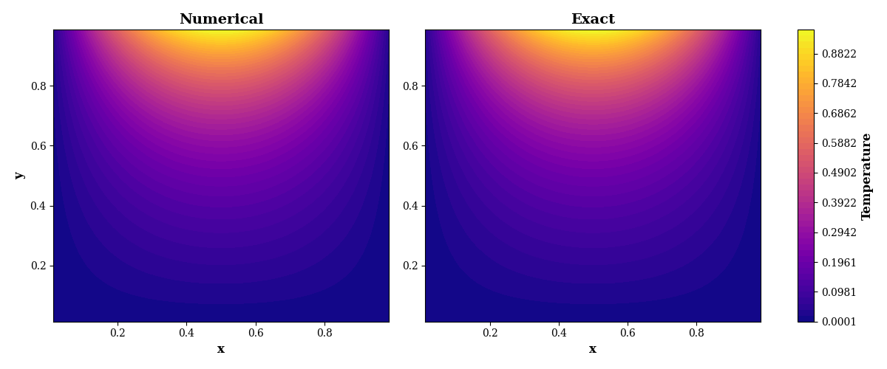
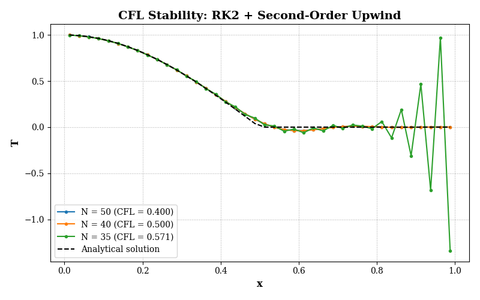
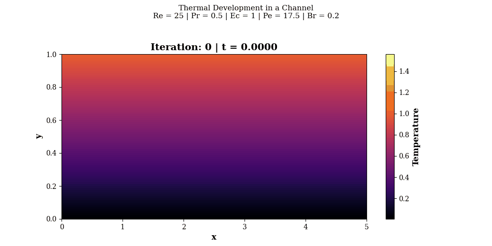

# Computational Fluid Dynamics 

This repository collects numerical modelling projects focused on the implementation, verification, and analysis of computational methods for fluid mechanics and heat transfer. The emphasis is on understanding how governing equations are discretized and solved, and on assessing numerical accuracy, convergence, stability, and computational behaviour.

The projects use Python for numerical implementation and LaTeX for technical reporting.

## Projects

### Project 01 — Steady Two-Dimensional Heat Conduction

**Problem:** Solve the steady two-dimensional Laplace equation on a square domain using a cell-centred finite-volume method.

$$
\nabla^2 T = 0.
$$

The discretization uses a structured Cartesian grid and Dirichlet boundary conditions. Numerical solutions are verified against an analytical solution. The project documents the development from the original master's implementation to a modular solver framework and compares iterative and direct solution methods.

**Methods implemented in V2:**

- **Point Gauss–Seidel:** point-wise iterative solution.
- **Successive Over-Relaxation (SOR):** point-wise iteration with a relaxation factor.
- **Line-SOR:** line-based solution of temperature corrections using a tridiagonal system.
- **Fully implicit direct method:** assembly and direct solution of the discrete linear system.

The repository preserves the original implementation and subsequent versions so the evolution of the code and report remains traceable.



*Representative result: temperature contours obtained using the fully implicit solution method.*

[Open the Project 01 folder](CFD_Project_01/)

### Project 02 — One-Dimensional Linear Advection

**Problem:** Solve the one-dimensional linear advection equation with a prescribed time-dependent inlet condition.

$$
\frac{\partial T}{\partial t}
+u\frac{\partial T}{\partial x}=0,
\qquad u=2.
$$

The solver separates spatial operators from time integrators, allowing numerical schemes to be combined without duplicating the time-marching algorithm.

**Methods and studies:**

- **Spatial discretization:** second-order upwind and second-order central schemes.
- **Time integration:** explicit midpoint Runge–Kutta (RK2) and classical fourth-order Runge–Kutta (RK4).
- **Verification:** comparison with the analytical solution, grid-refinement studies, and time-step refinement.
- **Stability analysis:** Fourier-mode analysis of the amplification factors and their dependence on the Courant number.
- **Error analysis:** RMS discrete $L^2$ errors and observed convergence orders.

For the second-order upwind scheme, the analysis gives a limiting Courant number of $C_{\max}=0.5$ with RK2 and approximately $C_{\max}=0.6963$ with RK4. The analysis also shows that second-order central differencing combined with explicit midpoint RK2 does not satisfy the absolute-stability condition for nonzero Fourier modes at any positive Courant number.



*Representative result: numerical and analytical solution profiles for the second-order upwind scheme advanced with RK2.*

[Open the Project 02 folder](CFD_Project_02/)

### Project 03 — Two-Dimensional Channel-Flow Energy Equation

**Problem:** Solve the two-dimensional energy equation in a channel flow, accounting for convective transport, thermal diffusion, and viscous dissipation.

$$
\begin{aligned}
\frac{\partial T}{\partial t}
+\frac{\partial (uT)}{\partial x}
+\frac{\partial (vT)}{\partial y}
={}&
\frac{1}{Pe}\nabla^2 T
+\frac{Br}{Pe}\Phi.
\end{aligned}
$$

The computational domain is a rectangular channel with a prescribed fully developed laminar velocity profile:

$$
u(y)=18y(1-y),\qquad v=0.
$$

The project uses a second-order, cell-centred finite-volume formulation on a structured Cartesian grid. The semi-discrete system is advanced in pseudo-time until the steady-state residual reaches the prescribed tolerance.

**Methods and studies:**

- **Spatial discretization:** second-order central-difference approximations for convection and diffusion.
- **Time integration:** approximate factorization (APF), sparse direct implicit method, explicit midpoint RK2, and classical RK4.
- **Stability analysis:** eigenvalue analysis of the semi-discrete spatial operator and amplification-factor evaluation for explicit methods.
- **Solver comparison:** residual convergence, iteration counts, and computation-time comparisons.
- **Numerical accuracy:** grid self-convergence and temporal accuracy studies.
- **Time-step efficiency:** investigation of the effects of time-step selection on convergence and computational cost.
- **Parameter study:** effects of the Peclet number, Brinkman number, and convection coefficient on the temperature distribution.

The Peclet number controls the relative strength of convective transport and thermal diffusion, while the Brinkman number determines the strength of viscous dissipation relative to thermal diffusion. The parameter study also introduces a convection coefficient to vary the convective contribution independently.

The following animation shows the temperature-field evolution during pseudo-time integration. It illustrates the combined effects of convection, thermal diffusion, and viscous dissipation as the solution approaches steady state.



*Representative result: pseudo-time evolution of the temperature field.*

[Open the Project 03 folder](CFD_Project_03/)

## Repository Layout

```text
.
├── README.md
│
├── CFD_Project_01/
│   └── CFD_Project_01_Heat_Conduction/
│       └── V2/
│           └── report/
│               └── latex/
│                   └── figures/
│                       └── implicit_temperature_contours.png
│
├── CFD_Project_02/
│   └── CFD_Project_02_1D_Advection/
│       └── report/
│           └── latex/
│               └── figures/
│                   └── rk2_2ndupwind_solution.png
│
└── CFD_03_2D_Energy_Equation/
    ├── Code/
    │   ├── src/
    │   ├── studies/
    │   └── main.py
    ├── Report/
    │   ├── figures/
    │   ├── sections/
    │   ├── main.tex
    │   └── ...
    └── results/
        ├── parameter_study/
        ├── solver_comparison/
        ├── time_step_efficiency/
        └── temperature_evolution.gif
```

Each project folder contains its own implementation, numerical results, and report materials. Refer to the documentation within each project for version-specific details and instructions for running the code or compiling the report.

## Main Topics

- Finite-volume discretization of partial differential equations.
- Iterative and direct numerical solution methods.
- Modular scientific Python programming.
- Analytical verification and grid-convergence studies.
- Runge–Kutta time integration.
- Pseudo-time integration for steady-state problems.
- Eigenvalue and Fourier stability analysis.
- Error estimation and numerical accuracy.
- Computational performance and time-step selection.
- Temperature-field visualization and technical reporting.
